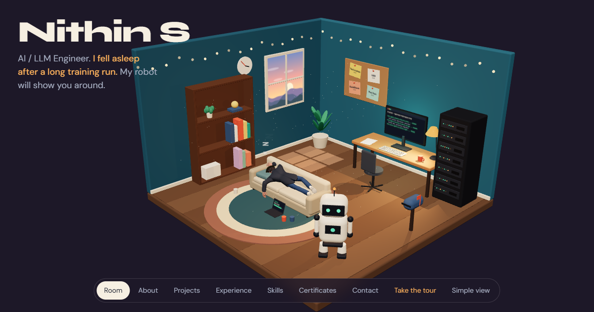

# Nithin S: 3D Portfolio

An interactive portfolio set in a small 3D room. I've fallen asleep on the sofa after a long training run, so my robot shows you around.

**[Explore the room](https://portfolio-nithin.pages.dev)** · [Simple view](https://portfolio-nithin.pages.dev/simple.html) · [Download my resume](https://portfolio-nithin.pages.dev/Nithin_S_Resume.pdf)



## What's in the room

| Click this | To see | What happens in the room |
| --- | --- | --- |
| Nithin, on the sofa | About me | His hanging arm sways when you hover over him |
| Monitor | 10 projects | The monitor shows the project you open |
| Pinboard | Work experience | The job's note lifts off the board |
| Server rack | Skills, and where I used each one | That group's row of lights stays on |
| Bookshelf | Certificates | The certificate's book slides off the shelf |
| Mailbox | Contact | The flag wiggles |
| Robot | A guided tour | It walks to each object and points at it |

On a first visit, the robot offers the tour automatically. You can also drag to turn the room, scroll to move between objects, or press `Esc` to go back.

## Built with

- [Three.js](https://threejs.org) for the 3D scene, built in code apart from the character model
- [Vite](https://vite.dev) for development and builds
- Plain JavaScript and CSS, with no UI framework
- Self-hosted fonts from [Fontsource](https://fontsource.org)
- Hosted on [Cloudflare Pages](https://pages.cloudflare.com)

## Run it locally

Requires Node.js 20 or later.

```bash
git clone https://github.com/nithinskumar866/Portfolio_nithin.git
cd Portfolio_nithin
npm install
npm run dev
```

| Command | What it does |
| --- | --- |
| `npm run dev` | Starts the development server |
| `npm run build` | Builds the site into `dist/` |
| `npm run preview` | Serves the production build locally |
| `npm run lint` | Runs ESLint |

## Project structure

```text
index.html         The 3D room page
simple.html        Plain page for quick reading and devices without WebGL
public/            Resume, character model, project screenshots and images
src/main.js        3D scene, camera, interactions and animation
src/content.js     All portfolio content and the information cards
src/tour.js        The robot's guided tour
src/styles.css     Styles for the room and its cards
src/simple.js      Builds the simple view from the same content
```

To update the portfolio, edit `src/content.js` and replace `public/Nithin_S_Resume.pdf`. Both the room and the simple view use the same content.

## Deploying

The site is hosted on Cloudflare Pages:

- **Build command:** `npm run build`
- **Output directory:** `dist`

### Guestbook

The personal room at `/personal` has a guestbook. Visitors' notes are saved by the Pages Functions in `functions/api/` and only appear on the corkboard after you approve them. To turn it on:

1. In the Cloudflare dashboard, go to **Storage & Databases → KV** and create a namespace, for example `portfolio-guestbook`.
2. In the Pages project, go to **Settings → Bindings**, add a **KV namespace** binding named `GUESTBOOK`, and pick that namespace.
3. In **Settings → Variables and Secrets**, add a secret named `ADMIN_TOKEN` with a long random value.
4. Redeploy, then open `/guestbook-admin.html`, enter the token, and approve or reject notes.

Until the binding exists, the board stays empty and the form says the guestbook isn't taking notes. The functions don't run under `npm run dev`.

## Credits

- The sleeping character is the `readyplayer.me.glb` avatar from the [three.js examples](https://github.com/mrdoob/three.js/tree/dev/examples/models/gltf), re-dressed and posed for this scene. Its file lists the copyright as Ready Player Me.
- The scooter in the personal room is `public/models/moped.fbx`, recoloured and given number plates. Its source and licence still need to be credited here.

## Contact

Nithin S · [nithinsofficial86@gmail.com](mailto:nithinsofficial86@gmail.com) · [LinkedIn](https://www.linkedin.com/in/nithin-s-52292b278) · [GitHub](https://github.com/nithinskumar866)
